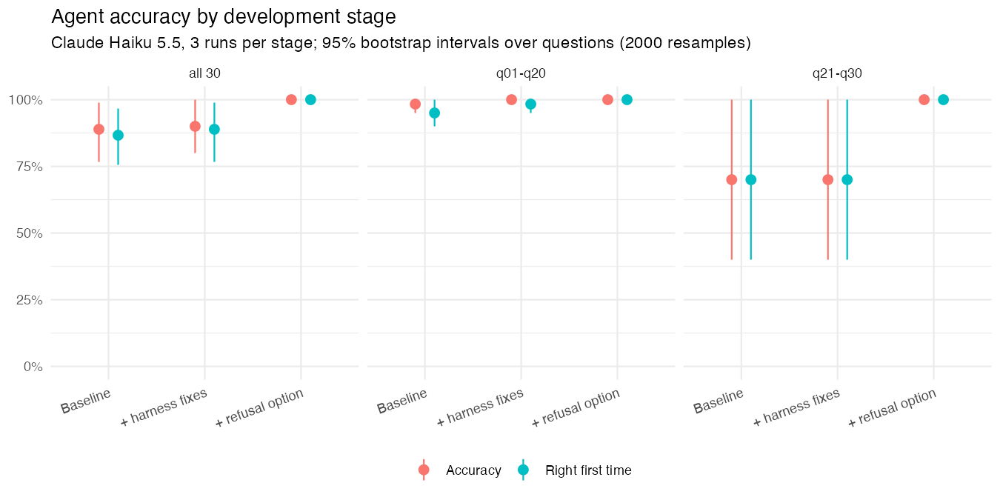
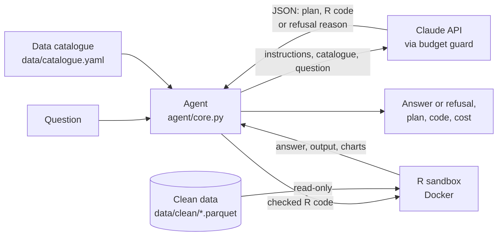

# Stats Analyst Agent

An LLM agent that answers questions about NHS England waiting list and A&E statistics by writing R code and running it in a sandbox.

## What it does

You ask a question in plain English. The agent reads a description of the data, writes R code to answer it, runs that code against cleaned copies of two NHS England datasets, and gives back the answer, its plan and the code it ran. If the data can't answer the question, it says so and explains why instead of guessing.

For example:

```
$ uv run python scripts/ask.py "How many incomplete RTT pathways were there in England in August 2026, and what share had waited 18 weeks or less?"

Answer:
  metric                                          value
  incomplete RTT pathways (reported, incl. NONC)  7189213
  share of pathways waiting 18 weeks or less      0.651613604994038

Plan:
  Read the RTT incomplete-provider table, keep only the all-specialties total rows
  (is_all_specialties_total == TRUE, C_999) for period 2026-08-01, then sum total_incomplete
  across providers for the national pathway count. For the share within 18 weeks, compute
  sum(within_18_weeks) / sum(known_clock_start) as a ratio of sums, not a mean of the
  percentage column. Figures are reported (non-submitting trusts missing) and include NONC
  pathways, so they run about 31k above NHS England's published headline.

R code:
  rtt <- arrow::read_parquet('data/clean/rtt_incomplete_provider.parquet')
  aug <- rtt |> filter(period == as.Date('2026-08-01'), is_all_specialties_total == TRUE)
  total <- sum(aug$total_incomplete, na.rm = TRUE)
  within <- sum(aug$within_18_weeks, na.rm = TRUE)
  known <- sum(aug$known_clock_start, na.rm = TRUE)
  answer <- data.frame(metric = c('incomplete RTT pathways (reported, incl. NONC)',
                                  'share of pathways waiting 18 weeks or less'),
                       value = c(total, within / known))

Retries: 0   Tokens: 154 in / 1,215 out   Cost: $0.0017
```

The `answer <-` line is wrapped here for width; everything else is printed exactly as it came back.

That is real output from Claude Haiku 5.5. Both figures match the evaluation's ground truth: 7,189,213 pathways, and 65.2% within 18 weeks.

## Why I built it

Public statistics are easy to get wrong in ways that look right. The RTT data has a total row that sits next to the specialty rows, so summing everything doubles the count. Averaging provider percentages gives a national figure 12 points too high. A trust merger looks like a waiting list doubling. A confident wrong answer to a question about public services is worse than no answer, because people act on it.

So the core of this project is the evaluation, not the agent. I built a set of questions with known answers before writing the agent, and every change since has been measured against it.

## Results

All results below are on Claude Haiku 5.5, 3 runs per stage, over the 30-question evaluation set. Intervals are 95% bootstrap intervals, resampling questions (2,000 resamples).

| Measure | Baseline | + harness fixes | + refusal option |
|---|---|---|---|
| Accuracy | 88.9% (76.7 to 98.9) | 90.0% (80.0 to 100) | 100% |
| Right first time | 86.7% (75.6 to 96.7) | 88.9% (76.7 to 98.9) | 100% |
| Retries per run | 2.67 | 2.00 | 0 |
| Cost per question | $0.00055 | $0.00050 | $0.00049 |
| Refusal accuracy (q23 to q25) | 0% | 0% | 100% |
| False refusals | 0 | 0 | 0 |

The stages:

- **Baseline:** the agent as first built.
- **+ harness fixes:** the check on the model's declared answer type was dropped, since the value itself was already checked. dplyr, tidyr and arrow were loaded before every script.
- **+ refusal option:** the model can reply with a reason the data can't answer, instead of R code.

Split by question set:

| Measure | Set | Baseline | + harness fixes | + refusal option |
|---|---|---|---|---|
| Accuracy | q01 to q20 | 98.3% (95.0 to 100) | 100% | 100% |
| | q21 to q30 | 70.0% (40.0 to 100) | 70.0% (40.0 to 100) | 100% |
| Right first time | q01 to q20 | 95.0% (90.0 to 100) | 98.3% (95.0 to 100) | 100% |
| | q21 to q30 | 70.0% (40.0 to 100) | 70.0% (40.0 to 100) | 100% |
| Retries per run | q01 to q20 | 0.67 | 0.33 | 0 |
| | q21 to q30 | 2.00 | 1.67 | 0 |



After the refusal option I added one more fix, a guard against a silent R mistake (see below). Over another 3 runs it kept every measure at 100%, at $0.00045 per question. The table, chart and per-question results are in [`docs/results/`](docs/results/). The full write-up is in [`eval/analysis/failures_baseline.md`](eval/analysis/failures_baseline.md).

## Where it went wrong

### Failure breakdown

These are the problems across the 3 baseline runs and 3 harness-fix runs on all 30 questions.

| Problem | Stage | Wrong answers | Retries | What fixed it |
|---|---|---|---|---|
| Couldn't refuse a question the data can't answer (q23 to q25) | Baseline and + harness fixes | 18 | 11 | The refusal option |
| Silent wrong answer from `filter(isFALSE(col))` (q04) | Baseline | 1 | 0 | The isFALSE() guard |
| Declared answer type didn't match, though the value was right | Baseline | 0 | 1 | Harness fix: the label check was dropped |
| Other R errors, fixed on retry (q14, q18) | Both | 0 | 2 | Recovered on retry |

On q23 to q25, the agent mostly set its answer to NA. In effect it was trying to say "can't answer" with no way to do so.

In the first 20-question runs, before these stages, the first attempts that failed had two causes:

- **The declared answer type:** 3 times, the model said "count" when the question wanted "number".
- **Missing dplyr:** 2 times, the code used `%>%` without loading dplyr.

Both were fixed by the harness fixes.

### Answers leaking through the catalogue

The agent reads a data catalogue that describes every column and its gotchas. The first version quoted exact figures as examples, and some of those figures were evaluation answers:
- the national waiting list total,
- the 4-hour and 18-week percentages,
- the provider counts.

I replaced them with descriptions ("about 31k higher than published") and scanned the catalogue and prompt for every expected answer. That scan was a one-off check, not an automated test. Accuracy didn't change when the leaks were removed. In 60 answers before the fix, the code always computed the value from the data and never wrote in a quoted figure. But an evaluation whose answers are in the prompt can't tell computing from copying.

### The units leak in refusal questions

Three questions (q23 to q25) ask for something the data can't provide, and the right answer is a refusal. The agent is only told what the question asks for, such as a number of patients, not that it should refuse. My first version passed the question's `units` field to the agent, and for these questions that field described the expected refusal. A test caught it before any live run used those questions. Refusal questions now give the agent separate `asks_for` and `asks_for_units` fields, and a test checks that no refusal prompt mentions refusing.

### The isFALSE() guard

In one baseline run, q04 returned 0 instead of the right count. The code used `filter(isFALSE(has_ae_activity))`. `isFALSE()` returns a single TRUE or FALSE for the whole column, not one per row, so the filter kept no rows. R raised no error and the answer was a valid number, so the retry, which only triggers on an error or a badly formatted answer, couldn't catch it.

I added a check that runs before the code does. It looks inside every `filter()` call for `isTRUE()` or `isFALSE()`, matching parentheses and ignoring strings and comments. If it finds one, it sends the code back with an explanation instead of running it. Replayed over all 411 code attempts from earlier runs, it flagged exactly one, the buggy attempt, and nothing else. The bug was too rare to measure directly: q04 got it right in 10 of 10 runs before the fix and 10 of 10 after.

## How it works



- **Agent** (`agent/core.py`):
  - Sends the question with the system prompt.
  - Validates the model's JSON reply with pydantic, and runs the pre-run isFALSE() check.
  - Runs the code and reads back the answer.
  - Sends any problem back once: invalid JSON, an R error, or a wrongly formatted answer. At most one retry.
- **Catalogue** (`data/catalogue.yaml`): every table and column with its type, meaning, units, examples and gotchas. It goes into the system prompt (about 8,700 tokens) and is cached across questions.
- **LLM:** the Claude API, with a fixed JSON schema for the reply: plan, datasets, R code, answer type, refusal reason. The answer itself comes from running the R code, not from the JSON. Every call goes through a spend cap.
- **R sandbox** (`sandbox/`): a fresh Docker container per run, with:
  - no network,
  - the data mounted read-only and a read-only system,
  - a 30-second limit and 1 GB of memory,
  - a non-root user.

  Each limit was checked by hand: blocked DNS and direct IP connections, a refused write, a stop at 30 seconds, and an out-of-memory kill.
- **Data** (`data/`): ingest scripts download the raw files and write one tidy parquet per dataset, printing row counts before and after every cleaning step.

The reasons behind each of these, and the alternatives I didn't take, are in [`docs/design-notes.md`](docs/design-notes.md).

## Evaluation method

- **Questions** ([`eval/questions.yaml`](eval/questions.yaml)): 30 questions, each pinning down the month, the measure and the set of providers, so there is exactly one correct answer.
  - **By category:** 11 traps, 6 lookups, 6 rankings, 4 trends and 3 comparisons.
  - **By dataset:** 18 use RTT, 11 use A&E and 1 joins them.
  - **q01 to q20** came first.
  - **q21 to q30** are harder: figures built up from provider data, a join, time series where mergers or missing submissions change the answer, and 3 questions the data can't answer.
- **Ground truth:** computed by a reproducible R script from the clean data ([`eval/ground_truth/compute_answers.R`](eval/ground_truth/compute_answers.R)) into [`answers.json`](eval/ground_truth/answers.json). The script stops if:
  - a ranking has a tie at its cut-off,
  - an answer has the wrong shape, or
  - a refusal question turns out to be answerable after all.
- **Grading** ([`eval/grading/grade.R`](eval/grading/grade.R)):

  | Answer type | Passes when |
  |---|---|
  | Number | within 1% of the expected value |
  | Count, ranking list, yes/no | exact match |
  | Refusal | the answer is a refusal, and its reason is at least 20 characters and names why, matching one of the question's keywords |

  Refusing a question that has an answer always fails.
- **Reproducibility:**
  - **Data date:** the answers are tied to the data as downloaded on 21 Oct 2026, and the script can be rerun after a refresh.
  - **Runs:** each run is saved with its model, prompts, responses, code and grades.
  - **Comparison:** [`eval/analysis/compare_runs.R`](eval/analysis/compare_runs.R) rebuilds the results table and chart, using a fixed random seed.

## Data

| Dataset | Source | Coverage | Size |
|---|---|---|---|
| RTT incomplete pathways, by provider and treatment function | [NHS England RTT waiting times](https://www.england.nhs.uk/statistics/statistical-work-areas/rtt-waiting-times/), full CSV extract, Part_2 | Sep 2024 to Aug 2026 (month-end snapshots) | 98,143 rows, 563 providers |
| A&E attendances, 4-hour performance and emergency admissions, by provider | [NHS England A&E attendances and emergency admissions](https://www.england.nhs.uk/statistics/statistical-work-areas/ae-waiting-times-and-activity/), monthly CSV | Oct 2024 to Sep 2026 (activity in the month) | 4,721 rows, 207 providers |

The files were downloaded on 21 Oct 2026. [`data/notes.md`](data/notes.md) lists the caveats, such as:
- The RTT figures include pathways for non-English commissioners, which NHS England leaves out of its published totals.
- Trusts that didn't submit are missing, not estimated.
- Several trusts merged during the period.

For the months I checked against NHS England's own publications, the figures match exactly:
- **RTT, Aug 2026 and Sep 2024:** once the non-English commissioner pathways are removed, they match the published reported totals.
- **A&E, Sep 2026:** they match the published national timeseries.

In every A&E file, the provider rows also add up to the file's national total.

Contains public sector information licensed under the Open Government Licence v3.0.

## Scope

**It can answer:**
- calculations on these two datasets within their coverage: RTT from Sep 2024 to Aug 2026, and A&E from Oct 2024 to Sep 2026,
- at provider, ICB, region or national level,
- totals, percentages, rankings, changes over time and simple joins between the two.

**It can't answer:**
- **Questions that need other data,** such as cancer waits, diagnostics, or 12-hour waits measured from arrival.
- **Months outside the coverage.**
- **Patient-level questions:** the RTT data counts pathways, not people.
- **Causal "why" questions,** such as why a trust's waiting list fell. The data shows what changed, not why.

In testing, it refused the three out-of-scope questions in the evaluation correctly every time and never refused an answerable one.

**What it actually does with "why" questions.** I tried two on Claude Haiku 5.5, and in both cases it answered rather than refused:
- **"Why did A&E performance fall in winter 2025?"** It returned a table comparing December to February in winter 2024/25 and 2025/26 (4-hour performance, Type 1 performance, trolley waits, admissions). Its plan said the tables show outcomes, not causes, and that "causes would need additional data".
- **"Why does Sheffield have no data after June 2025?"** It showed Sheffield's rows by month up to June 2025. Its plan said the data shows when the trust stops appearing but not why, and gave the catalogue's explanation (it didn't submit) as something the data can't confirm.

So for "why" questions it describes what changed and says the cause isn't in the data. Two weaknesses:
- **That caveat appears only in the plan,** not in the answer itself.
- **It doesn't check the question's premise.** Its own table showed all-types 4-hour performance was higher in December 2025 and February 2026 than a year earlier, and only slightly lower in January, but it didn't point out that the question assumes a fall the data mostly doesn't show.

## Try it yourself

You need everything in [Running locally](#running-locally), and an API key in `.env`.

```sh
uv run python scripts/ask.py "your question"
uv run python scripts/ask.py --interactive        # keep asking until you type quit
```

Three questions I tried on Claude Haiku 5.5, with the answers it gave:

1. *"How many incomplete RTT pathways were there in England in August 2026, and what share had waited 18 weeks or less?"* It answered 7,189,213 pathways and 0.652 (65.2%), as a small labelled table; the full output is above.
2. *"Which three NHS England regions had the lowest all-types A&E 4-hour performance in September 2026?"* It answered South West (71.8%), North West (71.8%) and Midlands (72.9%), as a table, which matches the evaluation's ground truth for the regional ranking.
3. *"How many patients spent more than 12 hours in A&E from arrival in September 2026?"* It refused:

   > The data cannot answer this. The ae_provider table's dta_wait_over_12hrs column counts patients who waited over 12 hours from the decision to admit to admission (trolley waits), not from arrival. The 12-hours-from-arrival figure is only in NHS England's separate ECDS supplementary analysis, which is not included.

Each question and its full result is saved to `asked/` (gitignored), with any chart the code made.

## Tech stack

- **Data and analysis:** R (tidyverse, arrow, boot), managed with renv
- **Agent:** Python, managed with uv
- **LLM:** Claude API (Claude Haiku 5.5 for development and all results so far; Claude Sonnet 5.5 configured for final evaluation runs), with a $5 spend limit for v1
- **Code execution:** Docker sandbox for agent-written R (no network, read-only data, time and memory limits)

### Cost controls

- **$5 cap per run.** A run is one process: one eval run, one smoke test, or one `ask.py` session. Before each call, its worst-case cost (all input tokens plus the full `max_tokens` of output) is checked against what's left. A call that could go over is refused with an error saying how much has been spent.
- **Cumulative ledger.** Every call's date, model, tokens and cost is appended to `.spend/ledger.json` (gitignored), so total spend over time is visible.
- **Configurable** with `BUDGET_USD` in `.env` (default 5). Prices come from `agent/llm/pricing.toml`, which records where they were checked and when.

## Repository structure

```
.
├── agent/                       # the agent
│   ├── core.py                  # question -> model -> checked R -> answer, with one retry
│   ├── prompts.py               # system prompt (instructions + catalogue) and question prompts
│   ├── schema.py                # the model's JSON reply (pydantic) and answer formats
│   └── llm/                     # Claude API client, spend cap, prices
├── sandbox/                     # Docker image and runner for agent-written R
├── data/                        # gitignored except ingest/, notes.md, catalogue.yaml
│   ├── ingest/                  # one script per dataset: download -> clean -> parquet
│   ├── raw/                     # untouched downloads (not in git)
│   ├── clean/                   # tidy parquet read by the agent (not in git)
│   ├── notes.md                 # gotchas that cause wrong answers
│   └── catalogue.yaml           # tables and columns: meaning, units, examples, gotchas
├── eval/                        # evaluation set, ground truth, grader, runner, analysis
├── scripts/                     # ask.py, and a one-off API smoke test
├── tests/                       # pytest suite (no API calls)
├── docs/                        # design notes and results (table, chart, per-question CSV)
├── R/                           # shared R helpers for the ingest scripts
├── DESCRIPTION / renv.lock      # R packages
├── pyproject.toml / uv.lock     # Python packages
├── setup_r.R                    # one-time R environment setup
└── LICENSE                      # MIT
```

## Running locally

You need R (4.3 or later), [uv](https://docs.astral.sh/uv/) and Docker. On a Mac, [colima](https://github.com/abiosoft/colima) works as the Docker runtime.

```sh
# R and Python environments
brew install harfbuzz fribidi libtiff         # macOS + Homebrew R only
Rscript setup_r.R                             # restores renv.lock
uv sync

# Data: newest 24 months from NHS England
Rscript data/ingest/rtt_incomplete_provider.R
Rscript data/ingest/ae_provider.R
Rscript eval/ground_truth/compute_answers.R   # rebuild the expected answers

# Sandbox
colima start                                  # or start Docker Desktop
docker build -f sandbox/image/Dockerfile -t stats-agent-sandbox .

# Checks without any API calls
uv run pytest
uv run python eval/run_eval.py --mock

# With an API key in .env (copy .env.example)
uv run python scripts/smoke_test_llm.py
uv run python eval/run_eval.py --model claude-haiku-5-5
```

If NHS England has revised past months since 21 Oct 2026, a fresh download can change some expected answers. Check the diff of `eval/ground_truth/answers.json` after rebuilding.

## Limitations

- **The evaluation is saturated.** At 100% in every run of the final stage, it can no longer tell a better agent from a worse one, so it can't measure the next change.
- **A 100% interval is a limit of the method, not certainty.** When every question scores 100%, every bootstrap resample does too, so the interval has zero width. An agent that gets about 1 question in 30 wrong on average would still score 30 out of 30 about a third of the time ((29/30) to the power 30 is about 0.36).
- **q21 to q30 has wide intervals** (40% to 100% before the final stage), because there are only 10 questions. The stage differences within that set rest on the 3 refusal questions.
- **Two datasets only,** and a snapshot as of 21 Oct 2026.
- **Small, single-model sample:** 3 runs per stage, all on Claude Haiku 5.5. Sonnet 5.5 hasn't been evaluated.
- **"Why" questions get a description, not a refusal,** with the "causes aren't in the data" caveat only in the plan, and the question's premise isn't checked. See [Scope](#scope).

## What's next

- **Harder questions,** so the score can move again: open questions graded against a checklist, and more multi-step and time-series questions.
- **More datasets,** with the catalogue retrieved per question instead of sent whole, since it won't fit as more data is added.
- **A Shiny demo,** so people can try it without a terminal.

## How this was built

I built this with Claude Code. It did the scaffolding, the infrastructure and most of the implementation. I made the design decisions, reviewed the data and every pull request, and chose each fix from the failure analysis. The ground truth is computed by a reproducible R script from the clean data.

## Licence

The code is licensed under the [MIT Licence](LICENSE), copyright 2026 Madhusudan Chakravarthy. The NHS England data is used under the Open Government Licence v3.0, as above.
